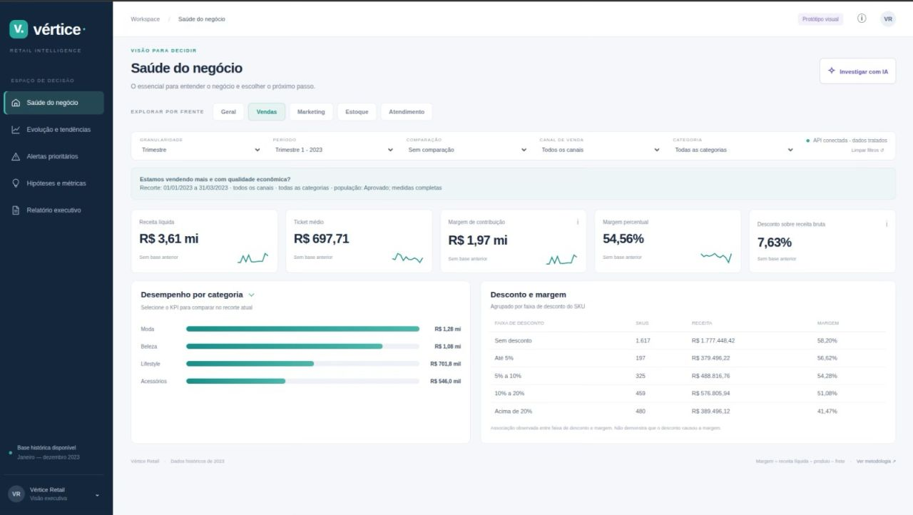

# Vértice Retail Intelligence

**🥈 2º lugar entre 20 grupos no BootCamp EloGroup 2026 – Nova Geração IA**
Mais de 1.050 inscritos, 80 selecionados, 6 semanas de imersão em IA, dados e negócios (10/08 a 09/09/2026).

Diagnóstico executivo e MVP de uma plataforma de inteligência de negócios para a Vértice Retail, uma varejista que cresce 40% ao ano em receita, mas não converte esse crescimento em rentabilidade. Projeto desenvolvido em squad.

📑 [Apresentação do case (PDF)](assets/apresentacao-vertice-retail.pdf) · 🏆 [Certificado](assets/certificado.png) · 🛠️ [Documentação técnica](docs/00-readme-tecnico.md)

---

## O problema

| Receita líquida 2023 | Crescimento | Margem de contribuição | Pedidos aprovados | Ticket médio |
|---|---|---|---|---|
| R$ 15,97 mi | +40% ao ano | 54,9% (sob pressão) | 23.388 | R$ 682,67 |

Dados espalhados em cinco áreas (vendas, marketing, clientes, estoque e atendimento), relatórios manuais e decisões por feeling. Mais dados não estavam virando mais capacidade de decisão.

**Pergunta central:** como usar dados e IA para melhorar rentabilidade, eficiência operacional e qualidade da tomada de decisão nos próximos 90 dias?

## Árvore de hipóteses

Testamos sete hipóteses para descobrir onde a rentabilidade se perde.

| # | Frente | Resultado | Evidência |
|---|---|---|---|
| H01 | Descontos | Refutada no agregado | Desconto médio subiu só 0,4 p.p. (7,2% → 7,6%) com margem estável em 54,9% |
| H02 + H04 | Canais e mídia | Validada | Marketplace é o maior canal (R$ 3,38 mi, 21,2% da receita), mas tem a menor margem (51,5%) e o pior ROAS (3,0x) |
| H03 | Estoque | **Validada, causa-raiz primária** | 800 SKUs (16% do catálogo) em ruptura ou estoque crítico; lead time de 55,2 dias contra 26,5 nos saudáveis; ponto de pedido fixo em 80 un. |
| H05 | Produtos | Refutada | Alto volume de vendas não implica baixa rentabilidade por SKU |
| H06 | Clientes | Validada | Bronze é 50% da base (LTV R$ 2.750); Platinum é 8,8% (LTV R$ 37 mil, 13,5x maior) |
| H07 | Atendimento | Validada como sintoma | 30% dos chamados são "onde está meu pedido?" (10.765 tickets, CSAT 2,9/5), reflexo de atrasos e rupturas |

## Oportunidades priorizadas

| Frente | Alavanca | Impacto estimado |
|---|---|---|
| Proteção de vendas | Recalcular o ponto de pedido pelo lead time real de cada fornecedor | R$ 600 mil a R$ 1,2 mi/ano |
| Eficiência de mídia | Realocar verba de campanhas com ROAS < 2,0x para Influenciadores e TikTok Ads (ROAS 7,8x e 4,7x) | R$ 450 mil/ano |
| Destravamento de capital | Desova controlada do estoque parado em Moda e Beleza | Até R$ 50 mi em 60 dias |
| Atendimento | Rastreamento proativo de entregas e autosserviço | R$ 120 mil/ano |

*Impactos estimados, sujeitos às premissas e à capacidade de execução.*

## A solução: Torre de Controle + Copilot de Rentabilidade

1. **Saúde do Negócio:** cinco bases integradas, KPIs executivos por área e filtros por período, canal e categoria.
2. **Alertas e Oportunidades:** desvios relevantes sinalizados, com impacto financeiro estimado.
3. **Copilot de IA:** investigação guiada das hipóteses em linguagem natural.

Fluxo: **dados → evidência → hipótese → investigação → ação.**

A regra principal do produto: os números vêm sempre da camada analítica, e a IA só interpreta. A IA apoia a decisão, não a substitui.

## Roadmap 30-60-90

| 0–30 dias: quick wins | 31–60 dias: ajustes operacionais | 61–90 dias: escala e governança |
|---|---|---|
| Revisar campanhas com ROAS < 2,0x | Recalibrar o ponto de pedido | Torre de Controle em produção |
| Rastreamento proativo de pedidos | Iniciar desova do estoque de Moda | Comitê quinzenal de margem |
| Frete mínimo no Marketplace para pedidos de margem comprimida | Revisar alocação de mídia | Migrar clientes Bronze para faixas de maior LTV |

## Stack do MVP

Python (pandas) na camada analítica e de alertas, API analítica, protótipo web em HTML/CSS/JavaScript e testes automatizados com `unittest`. Detalhes de execução na [documentação técnica](docs/00-readme-tecnico.md).

---

*Case proposto pela EloGroup no BootCamp 2026, com dados do Data Room da Vértice Retail.*
